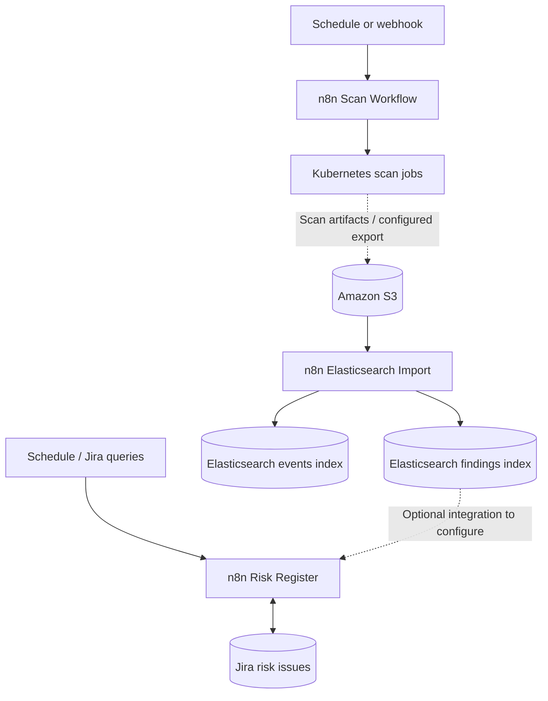

# n8n Security Automation Workflows

A collection of **n8n automation workflows** for orchestrating security scans, ingesting findings into Elasticsearch, and maintaining risk records in Jira. The workflows demonstrate how low-code orchestration can connect Kubernetes, AWS S3, Elasticsearch, and Jira into a security operations pipeline.

> **Note:** These are exported workflow definitions, not a turnkey deployment. Importing them requires configuring your own infrastructure, endpoints, credentials, permissions, and field mappings. Review all nodes before enabling scheduled or webhook triggers.

## Workflows

| Workflow | Purpose | Key integrations |
| --- | --- | --- |
| [Scan Workflow](./Scan%20Worflow.json) | Orchestrates Kubernetes scan jobs from a webhook, with a scheduled HTTP invocation path. | n8n Webhook, HTTP, Kubernetes job API |
| [Elasticsearch Import](./Import%20Workflow%28Elastic%29.json) | Retrieves scan artifacts from S3, processes and deduplicates findings, and indexes findings and events. | AWS S3, Elasticsearch, n8n Code |
| [Risk Register](./Risk%20Register%20Workflow.json) | Automates risk-register processing and Jira issue updates using scheduled execution and field mapping. | Jira, HTTP, n8n Code |

*File names above match the repository, including the existing `Scan Worflow.json` spelling.*

## Architecture



The diagram illustrates the intended security-automation ecosystem. **Dashed connections are conceptual or environment-dependent**; the exported workflows should not be assumed to implement every cross-workflow handoff automatically.

## Workflow details

### 1. Scan Workflow

**File:** [`Scan Worflow.json`](./Scan%20Worflow.json)

This workflow provides a webhook-driven path for launching and managing scan jobs in Kubernetes. Its exported nodes include YAML parsing, job creation/deletion, conditional processing, waiting, and a schedule trigger that calls an HTTP endpoint.

**Configuration checklist**
- Supply the Kubernetes API endpoint, authentication, namespace, and required RBAC permissions.
- Review the job manifest and YAML parsing logic before allowing job creation.
- Update the HTTP Request node: the exported scheduled path points to `http://localhost:5678/webhook/deploy-scan/?tool=all`, which will only work where that address resolves to the correct n8n instance.
- Protect the webhook with suitable authentication, network controls, and input validation.
- Verify how scan outputs are stored or exported in your environment.

### 2. Elasticsearch Import Workflow

**File:** [`Import Workflow(Elastic).json`](./Import%20Workflow%28Elastic%29.json)

This workflow processes scan artifacts from AWS S3 and writes normalized findings to Elasticsearch. The exported flow includes S3 object listing, file extraction, code-based processing, fingerprint-based grouping, merging with existing records, and indexing of both current findings and events.

**Notable behavior**
- Uses a finding fingerprint to group repeated observations.
- Reads existing Elasticsearch documents before updating or creating findings.
- Tracks occurrence counts, last-seen timestamps, and associated endpoints in the merge logic.
- Writes separate event records to preserve finding activity.

**Configuration checklist**
- Configure AWS credentials with least-privilege access to the relevant S3 bucket and prefixes.
- Configure Elasticsearch credentials and the appropriate index names/mappings.
- Review input file formats, filtering, normalization, and fingerprint rules.
- Test reprocessing and duplicate handling with sample scan artifacts.
- Review processed-file movement and retention behavior before enabling automation.

### 3. Risk Register Workflow

**File:** [`Risk Register Workflow.json`](./Risk%20Register%20Workflow.json)

This workflow automates risk-register operations in Jira. Its export contains scheduled execution, HTTP requests, Jira field mappings, looping/batching, and JQL construction for querying risk records.

**Configuration checklist**
- Configure Jira authentication, base URL, project identifiers, and access permissions.
- Adapt custom field IDs to the target Jira project; exported mappings include risk-related fields such as identification source, affected assets, and risk description.
- Review JQL queries and update logic before enabling writes.
- Test with nonproduction Jira issues to avoid unintended edits or duplicate records.

## Prerequisites

- A running [n8n](https://docs.n8n.io/) instance that supports the node versions used in these exports.
- Access to a Kubernetes cluster and permissions appropriate to the scan workflow.
- AWS S3 storage for scan artifacts used by the import workflow.
- An Elasticsearch deployment and suitable index permissions.
- A Jira instance with the relevant project, issue types, and custom fields.
- Network connectivity between n8n and each configured service.

Only the services required by the workflow you import need to be configured.

## Getting started

1. **Clone the repository:**

   ```bash
   git clone https://github.com/cray9741/N8N_Workflows.git
   cd N8N_Workflows
   ```

2. **Import a workflow:** Open n8n, create or open a workflow, and choose the option to import from a file. Select one of the JSON exports in this repository.
3. **Configure credentials:** Reconnect every credential-dependent node to credentials in your own n8n instance. Exported credential references do not grant access to the original services.
4. **Review environment-specific values:** Update URLs, bucket names, prefixes, Elasticsearch indices, Jira project settings, Kubernetes namespaces, and field IDs as needed.
5. **Test safely:** Execute individual nodes and the complete workflow with nonproduction data. Confirm expected results and failure behavior.
6. **Enable triggers:** Activate schedules or production webhooks only after validating permissions, security controls, and downstream effects.

## Security considerations

These workflows interact with infrastructure and security data. Before deploying:

- **Never commit secrets:** Store tokens, passwords, and API keys in n8n credentials or an appropriate secrets manager.
- **Restrict permissions:** Use least-privilege IAM, Kubernetes RBAC, Elasticsearch roles, and Jira access.
- **Secure triggers:** Authenticate webhook requests and restrict access to administrative endpoints.
- **Validate inputs:** Treat webhook payloads, YAML, downloaded files, and external API responses as untrusted.
- **Protect findings:** Limit access to scan artifacts and risk records; configure retention and audit logging.
- **Inspect exports:** Review hard-coded URLs, identifiers, and configuration values before sharing or deploying.

## Troubleshooting

| Symptom | What to check |
| --- | --- |
| Webhook does not trigger | Active workflow, webhook URL, HTTP method, authentication, and network reachability |
| Scan job fails | Kubernetes API access, RBAC, namespace, job manifest, and pod logs |
| S3 files are not found | Bucket/prefix configuration, IAM permissions, and expected file layout |
| Elasticsearch indexing fails | Credentials, connectivity, index mappings, document shape, and permissions |
| Jira fields do not update | Project permissions, issue type, JQL, and instance-specific custom field IDs |
| Schedule works only locally | Replace exported `localhost` references with an endpoint reachable from the n8n runtime |

## Repository structure

```text
N8N_Workflows/
├── Import Workflow(Elastic).json
├── Risk Register Workflow.json
├── Scan Worflow.json
└── README.md
```

## Contributing

Suggestions and improvements are welcome through GitHub issues or pull requests. When contributing a workflow, remove sensitive configuration, document external dependencies, and include clear setup and testing notes.

## License

No license is currently specified in this repository. Unless a license is added, reuse and redistribution are not automatically granted by an open GitHub repository.

---

**Maintainer:** [cray9741](https://github.com/cray9741)  
**Repository:** [N8N_Workflows](https://github.com/cray9741/N8N_Workflows)
